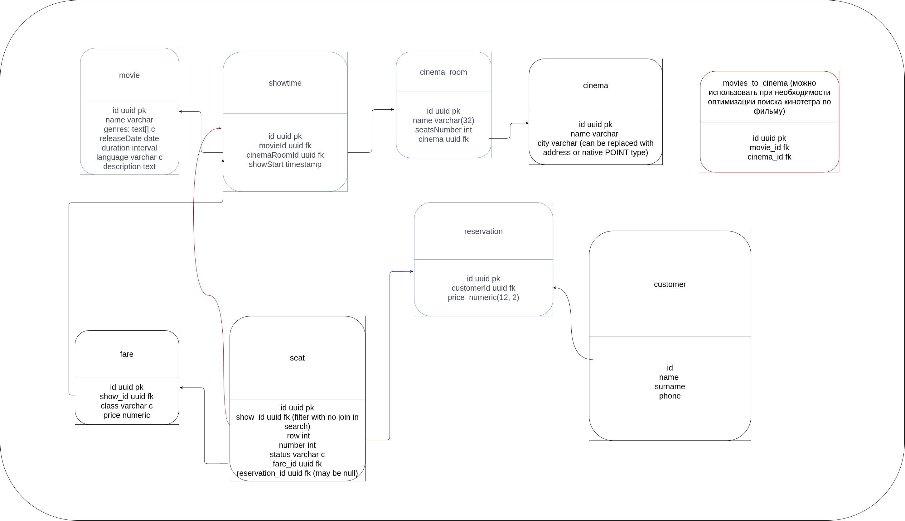

# dbcourseAutumn2026

Это репозиторий, которым можно воспользоваться в качестве примера для своего собственного проекта.
Этот репозиторий содержит только некий пример кода, который не является эталонным или законченным.
Код в этом репозитории будет обновляться по ходу курса. 

Тема вашего собственного проекта будет отличаться от темы проекта в этом репозитории.

## Здесь хранится код и миграции для сайта для сети кинотеатров.
В качестве БД используется postgres, в качестве протокола клиент серверного взаимодействия - REST.

## Использованные требования

### Функциональные требования:
- Пользователь может искать фильм по названию, жанру, дате выхода, продолжительности, языку (а также по времени сеанса).
- Пользователь может просмотреть описание фильма и всю информацию из пункта 1 в карточке фильма.
- Когда пользователь выбирает фильм, система отображает список различных залов в кинотеатрах, где транслируется фильм, с указанием расписания сеансов.
- Пользователь должен иметь возможность фильтровать кинотеатры по городу и времени сеанса.
- Пользователь должен иметь возможность выбрать сеанс в конкретном кинотеатре и забронировать место в зале.
- Система отображает наличие мест, и пользователи могут выбирать предпочтительные места.
Система также показывает цену за место. Места в одном зале и между разными залами могут отличаться по цене.
- Клиент должен иметь возможность выбрать несколько мест в соответствии со своими предпочтениями.
- На данный момент мы решили, что клиенты могут платить только кэшем.
- Клиенты не должны иметь возможность бронировать одно и то же место.
- Пользователь должен иметь возможность просмотреть свои брони и отменить бронь.
- Администраторы системы должны иметь возможность добавлять и изменять все ключвые сущности системы

### Нефункциональные требования:

- чтение будет чаще записи, нужна большая ропускная способность на чтение 
- отдаем приоритет скорости в поиске и консистентности в бронировании

## Выделенные сущности системы

- Movie
- Showtime
- Cinema_room
- Cinema
- Fare
- Seat
- Reservation
- Customer

## Примерная схема зависимостей в БД 

### Причины наличия избыточности и нарушения нормальных форм

#### Избыточность

- аттрибут show_id дублируется в таблицах seat и fare, чтобы обеспечить более быстрый поиск доступных мест(seat) для конкретного сеанса(showtime)

#### Нарушение нормальных форм

- таблица movie содержит аттрибут genres с типом text[], поскольку мы считаем, что нам не требуются у жанра его собственные аттрибуты и мы не будем использовать относительно колонки genres никакие операции, кроме &&, @>, <@, = (поддерживаемые GIN-индексом).   
